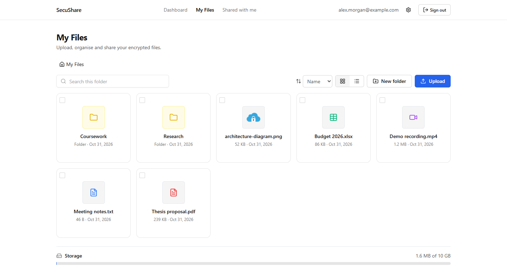

# SecuShare

End-to-end encrypted file storage and sharing. Files are encrypted in the browser before upload; the server only ever stores ciphertext and never sees file contents, file keys, or your password.



- **Private storage**: folders, drag-and-drop uploads (including whole folders), rename, move, delete, per-user quota.
- **Share with people**: share a file with another registered user; it appears in their *Shared with me*.
- **Share links**: anyone-with-the-link or specific-people-only, optional password, expiry and download limit, revocable at any time.
- **Accounts**: email verification, password change, account deletion.

## Contents

- [Quick start (Docker)](#quick-start-docker)
- [Local development](#local-development)
- [Security model](#security-model)
- [Configuration](#configuration)
- [Deployment](#deployment)
- [Project structure](#project-structure)
- [API overview](#api-overview)
- [License](#license)

## Quick start (Docker)

Requires Docker with Compose v2.

```bash
git clone <this repo> secu-share && cd secu-share
cp .env.example .env
# Set SESSION_SECRET in .env, e.g. to the output of: openssl rand -base64 48
docker compose up -d --build
```

- App: http://localhost:8080
- Emails (verification links): http://localhost:8025 (Mailpit catches all outgoing mail locally)

This starts MongoDB, Mailpit, the API, and the web app (nginx serving the SPA and proxying `/api`). Uploaded files are kept in the `uploads` volume.

## Local development

Requires Node.js 22+ and a MongoDB instance (e.g. `docker run -d -p 27017:27017 mongo:7`).

```bash
# API: http://localhost:4000
cd backend
cp .env.example .env      # defaults work with a local MongoDB
npm install
npm run dev

# Web app: http://localhost:5173 (proxies /api to the API)
cd frontend
npm install
npm run dev
```

Without SMTP configured, verification links are printed in the API log.

### Checks

| | API (`backend/`) | Web (`frontend/`) |
|---|---|---|
| Tests | `npm test`: integration tests against an in-memory MongoDB | `npm test`: crypto unit tests |
| Lint | `npm run lint` | `npm run lint` |
| Types | n/a | `npm run typecheck` |

CI runs all of these, plus `npm audit` and a Docker build, on every push and pull request.

## Security model

### What is protected

| Data | Who can read it |
|---|---|
| File contents | Only you and the people you share with. Encrypted with AES-256-GCM in the browser. |
| File keys | Stored only *wrapped* with RSA-OAEP-3072 public keys (yours, and each recipient's). |
| Your password | Never sent. The browser derives two independent values from it (PBKDF2-SHA256, 600,000 iterations, then HKDF): an auth hash sent to the server (stored with bcrypt), and a key that encrypts your private key. |
| Share-link keys | Carried in the URL fragment (`/share/<token>#<key>`), which browsers never send to servers. |

Each file has its own random key. Content is encrypted in 1 MiB chunks; each chunk authenticates its position and whether it is the last one, so tampering, reordering, or truncation is detected on download.

### What the server can see

- File and folder **names**, sizes, MIME types, and folder structure
- Who shares which file with whom, and when
- Account emails and names, IP addresses, access times

### Things to know

- **There is no password recovery.** A forgotten password means the files can't be decrypted. Changing your password (while you know it) is supported and keeps all files.
- **You trust the served code.** As with any web-based end-to-end encryption, a compromised server could serve modified JavaScript. Self-hosting removes that third party.
- **Recipients' public keys come from the server.** When you share with a person, the browser encrypts the file key with the public key the server returns for their email. A malicious server could return its own key instead. Messengers such as Signal counter this by letting users compare key fingerprints; SecuShare does not do that yet.
- **A share link is a capability.** Anyone with the full link can open a public link. Use a password, expiry, download limit, or a specific-people link for sensitive files, and revoke links you no longer need.
- **Specific-people access requires a verified email.** This stops someone from registering another person's address first to receive files meant for them.
- Unlocked keys are kept in the browser (IndexedDB, as non-extractable keys) until you sign out.

### Server-side hardening

Session cookies are `HttpOnly`, and the session ID is regenerated on login. Cross-site writes are blocked by an Origin check, and CORS uses an exact allowlist. Login and share-link passwords are rate-limited, and login timing is equalised. Every request body is validated (zod). Response objects are explicitly serialised, so internal fields never leak. Uploads are streamed to disk, never buffered in memory. Download limits are enforced atomically. Storage keys are random, so names can never collide.

## Configuration

The API validates its environment at startup and exits with a readable message if anything is wrong. See [`backend/.env.example`](backend/.env.example) for every option. The most important:

| Variable | Default | Purpose |
|---|---|---|
| `MONGODB_URI` | required | MongoDB connection string |
| `SESSION_SECRET` | required | At least 32 random characters |
| `FRONTEND_URL` | required | Public app URL(s), comma-separated; used for CORS and email links |
| `COOKIE_SAMESITE` | `lax` | `none` if the app and API are on different sites |
| `COOKIE_SECURE` | `true` in production | Must be `true` when served over HTTPS |
| `TRUST_PROXY` | `0` | Number of reverse proxies in front of the API |
| `STORAGE_DRIVER` | `local` | `local` (disk) or `s3` (AWS S3, MinIO, Cloudflare R2, ...) |
| `MAX_FILE_SIZE` | 100 MiB | Per-file limit |
| `STORAGE_QUOTA_BYTES` | 10 GiB | Per-user quota |
| `SMTP_HOST`, `MAIL_FROM`, ... | unset | Email delivery for verification links |

Web app build variables (see [`frontend/.env.example`](frontend/.env.example)): `VITE_API_URL` (only if the API is on another origin) and `VITE_MAX_FILE_SIZE`.

## Deployment

**Recommended: one origin.** Serve the web app and the API from the same domain, either with the bundled `docker-compose.yml` behind an HTTPS reverse proxy (Caddy, Traefik, nginx), or any setup that routes `/api` to the API. Then set:

```
APP_URL=https://files.example.com
COOKIE_SECURE=true
```

and configure real SMTP.

**Split hosting** (e.g. the web app on Vercel, the API elsewhere). `frontend/vercel.json` already contains SPA rewrites and security headers.

- Web app: `VITE_API_URL=https://api.example.com/api`
- API: `FRONTEND_URL=https://your-app.vercel.app`, `COOKIE_SAMESITE=none`, `COOKIE_SECURE=true`, and `TRUST_PROXY=1` if the API sits behind a proxy.
- Preview deployments: `CORS_ORIGIN_PATTERN=^https://your-app-[a-z0-9-]+\.vercel\.app$`

Some browsers restrict third-party cookies, so the single-origin setup is more robust.

Rate limits are kept in memory. If you run several API instances, plug a shared store into `backend/src/middlewares/rateLimits.js`.

## Project structure

```
backend/                 Express 5 API (Node 22, MongoDB/Mongoose)
  src/
    config/              Environment validation
    routes/              auth, files, links, shared-with-me, users, public (share links)
    services/            File deletion/quota, link access rules, mailer, serializers
    storage/             Local disk and S3-compatible blob storage
    middlewares/         Auth, rate limits, origin guard, errors
    models/              User, File, Share, ShareLink
  test/                  Integration tests (node:test, supertest, in-memory MongoDB)
frontend/                React 19 + Vite + Tailwind SPA
  src/
    libs/crypto.ts       All client-side cryptography (+ tests)
    libs/keyStore.ts     IndexedDB storage for unlocked keys
    features/            auth, files, sharing, upload
    pages/               Route components
docker-compose.yml       MongoDB + Mailpit + API + web
```

## API overview

All endpoints are under `/api` and use JSON, except uploads (`multipart/form-data`) and file content (`application/octet-stream`, always ciphertext).

| Area | Endpoints |
|---|---|
| Auth | `POST /auth/register`, `/auth/login`, `/auth/logout`, `/auth/verify-email`, `/auth/resend-verification`, `/auth/change-password`; `GET /auth/me`, `/auth/keys`; `DELETE /auth/account` |
| Files | `GET /files?path=`, `/files/folders`, `/files/recent`, `/files/stats`, `/files/:id/content`; `POST /files` (upload), `/files/folders`, `/files/bulk-delete`; `PATCH /files/:id` (rename/move); `DELETE /files/:id` |
| Sharing | `GET/POST /files/:id/links`, `DELETE /links/:id`, `GET /links`; `GET/POST /files/:id/shares`, `DELETE /files/:id/shares/:userId`; `GET /users/lookup?email=` |
| Shared with me | `GET /shared-with-me`, `/shared-with-me/unseen-count`; `POST /shared-with-me/mark-seen`; `DELETE /shared-with-me/:shareId` |
| Share links (public) | `POST /public/links/:token` (info), `/public/links/:token/download`, `/public/links/:token/save` |
| Health | `GET /health` |

## License

Copyright 2026 Khandaker Abrar Yasir. Licensed under the [Apache License, Version 2.0](LICENSE).
